## 🚀 Projects

<!-- TODO: replace these sample rows with your real repositories -->

| Project | What it does | Stack | Link |
| :-- | :-- | :-- | :-- |
| **portfolio-site** | Personal portfolio with smooth animations | React · JavaScript | [repo](https://github.com/ABHAYS-8004/portfolio-site) |
| **mern-chat-app** | Real-time chat with rooms and auth | React · Node.js · MongoDB | [repo](https://github.com/ABHAYS-8004/mern-chat-app) |
| **algo-playground-cpp** | Data structures & algorithms practice in C++ | C++ | [repo](https://github.com/ABHAYS-8004/algo-playground-cpp) |
| **py-automation** | Small Python scripts that save time | Python | [repo](https://github.com/ABHAYS-8004/py-automation) |
| **sql-practice** | Queries and schema design exercises | SQL | [repo](https://github.com/ABHAYS-8004/sql-practice) |

## 🌃 Contribution city

  

Rebuilt every day by [`profile-3d.yml`](.github/workflows/profile-3d.yml) using [yoshi389111/github-profile-3d-contrib](https://github.com/yoshi389111/github-profile-3d-contrib).

## 📬 Connect

